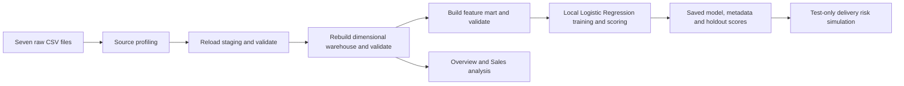
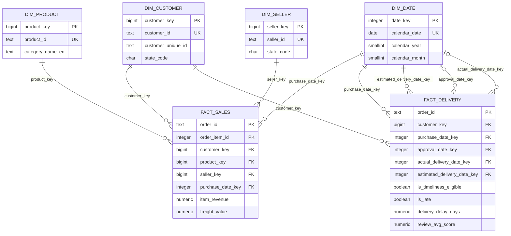
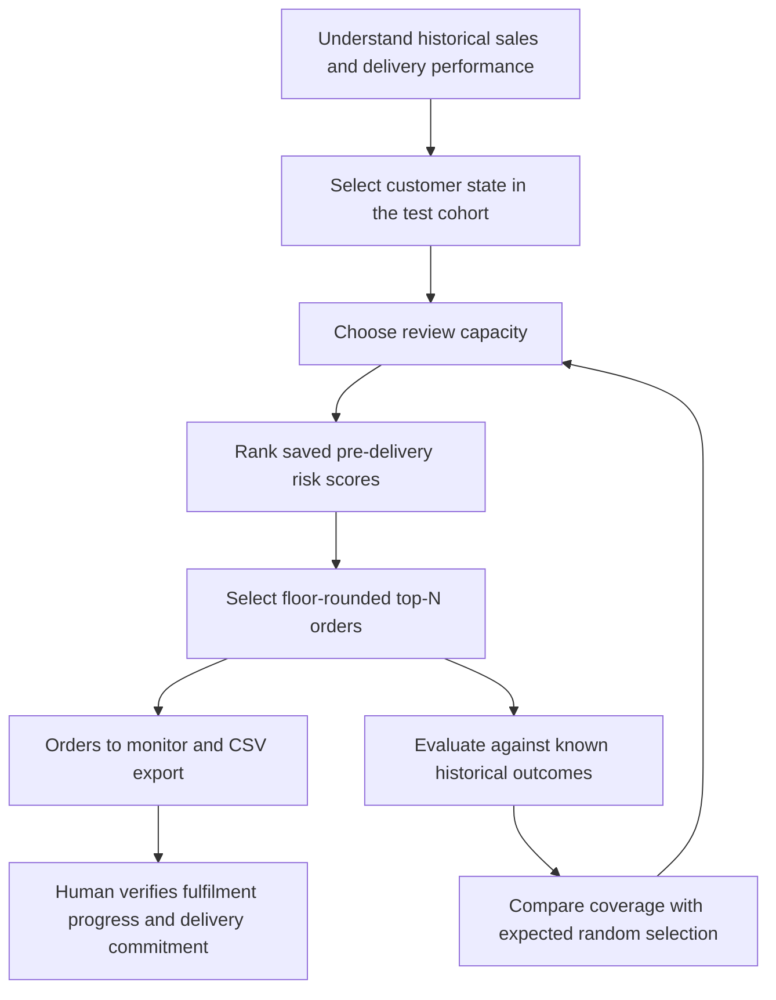

# Warehouse and DSS diagrams

These diagrams describe the current implementation. Render the Mermaid blocks or redraw them for the report; do not present conceptual connections to the mart as physical foreign-key constraints.

## System and ETL flow

The three Airflow DAGs run manually in sequence. Training/scoring is a separate local command. A successful upstream rebuild invalidates saved scores; the operator must complete downstream rebuilds and scoring before using the risk page again.

## Dimensional warehouse

This diagram shows selected fields; the complete 63-column physical contract is in data_dictionary.md. Four dimensions and two facts form a shared-dimension fact constellation. Each fact has a star-shaped relationship to its dimensions. The date table plays four roles for delivery; approval and actual-delivery foreign keys are nullable. Each sales row represents one item unit; unit counts use `COUNT(*)` without a stored quantity column.

fact_sales has one row per (order_id, order_item_id); fact_delivery has one row per order. Do not join the two facts and sum order-level values without respecting their different grains. Aggregate item data to order grain first for the ML mart. Reviews are deduplicated per (order_id, review_id), then aggregated by order before being attached to fact_delivery.

## Decision workflow

The final human action is a proposed operational workflow, not a measured intervention performed by this project. The model ranks orders without using outcomes; actual outcomes are only used for retrospective evaluation. One model is managed through its pipeline, artifact, metadata, evaluation and scoring lifecycle; there is no multi-model registry.
